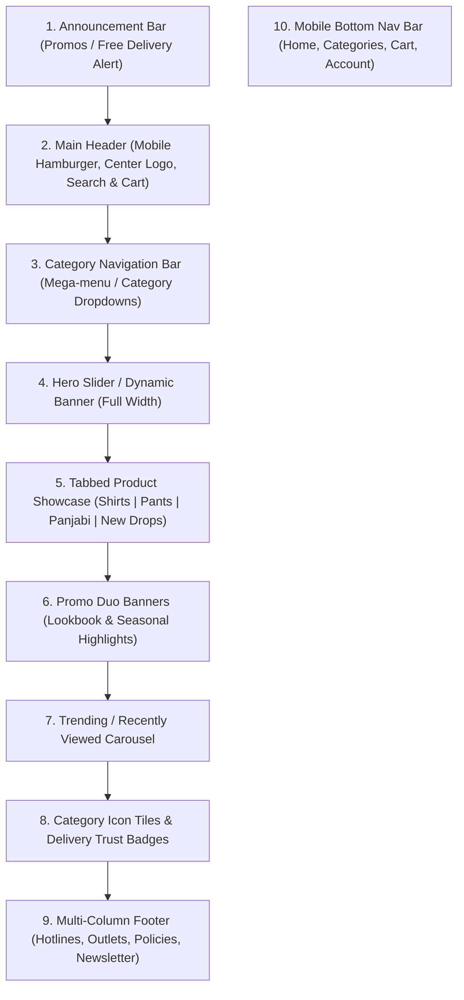

# UI/UX Design Analysis: ARJO (arjobd.com) & Implementation Plan for Project ECO

> **Purpose:** Detailed design and architectural breakdown of the shopping experience on [arjobd.com](https://arjobd.com/) (contemporary fashion e-commerce in Bangladesh). This document defines how to adapt its best-in-class UI/UX patterns into an **original, unique brand interface** for **Project ECO**.
>
> *(Note: All brand names, logos, original photography, and proprietary copy remain the intellectual property of ARJO BD. Project ECO will use original branding, clean typography, licensed/mock imagery, and modern Angular SCSS styling.)*

---

## 1. Executive Summary & Brand Vibe

ARJO BD uses a **clean, modern minimalist aesthetic** common in high-end apparel and streetwear brands:
- **Tone:** Premium, contemporary, uncluttered, image-first.
- **Audience:** Bangladeshi modern fashion shoppers with heavy mobile engagement.
- **Key UX Pillars:**
  1. Instant visual browsing (hero slider, tabbed category drops, hover-reveal alternate image).
  2. Frictionless cart drawer (slide-in offcanvas without page reload).
  3. Mobile-first sticky bottom navigation for phone shoppers.
  4. Localized commerce elements (Bangladeshi Taka `৳`, Cash on Delivery, WhatsApp/hotline accessibility, city/district shipping address conventions).

---

## 2. Design System & Visual Tokens

| Design Token | ARJO BD Pattern | Recommended for Project ECO |
|---|---|---|
| **Primary Typography** | `Jost` (Google Font, geometric sans-serif) | `Jost` or `Plus Jakarta Sans` with clean tabular numbers |
| **Heading Style** | Bold uppercase section headers (`RECENTLY STALKED`, `NEW DROPS`) | Uppercase tracking (`letter-spacing: 0.05em`), font-weight 600-700 |
| **Primary Color** | Deep Onyx `#222222` / `#000000` | Jet Black `#1E232A` (sleek, high contrast) |
| **Background Color** | Pure White `#FFFFFF` + Light Off-White `#F9F9F9` | Neutral Light `#FFFFFF` and Soft Canvas `#F8F9FA` |
| **Border / Dividers** | Subtle grey `#EBEBEB` and `#E6E6E6` | Subtle border `#E5E7EB` |
| **Accent / Badge** | Berry Pink `#EB2771` (badges/sale) & `#D69C00` (ratings) | Terracotta/Emerald Accent (e.g. `#E11D48` for sale, `#059669` for stock) |
| **Buttons** | Flat, sharp/semi-rounded, high-contrast dark fills and clean outline borders | 4px-6px border-radius, smooth 200ms ease transitions |
| **Currency** | Bangladeshi Taka sign `৳` (e.g., `৳ 1,490`) | Standard `৳` prefix with comma formatting (e.g., `৳ 1,490.00`) |

---

## 3. Global Layout Architecture



### 3.1 Header & Navigation
- **Announcement Bar:** Dismissible slim top banner (`bg-dark`, white text) for delivery thresholds (e.g., *"Free shipping on orders over ৳ 2,500"*).
- **Desktop Header:** 3-column balanced grid:
  - **Left:** Search bar / trigger, quick customer links.
  - **Center:** Crisp logo mark.
  - **Right:** Account sign-in / profile, wishlist count, mini-cart toggle button with dynamic badge counter.
- **Main Nav Strip:** Horizontal centered menu with hover dropdowns:
  - *Shirts* (Classic Fit, Formal, Half Sleeve, Over-Shirt, Katua)
  - *Panjabi* (Classic Fit, Short Panjabi, Embroidered)
  - *T-Shirts & Polos*
  - *Pants* (Chino, Denim, Cargo, Trousers, Shorts)
  - *Winter / Outerwear* (Jackets, Shackets, Sweatshirts)
- **Sticky Behavior:** Navbar shrinks slightly and stays pinned to top during scroll.

### 3.2 Mobile Navigation & Sticky Footer Bar
- **Offcanvas Drawer:** Side-drawer opening from left with accordion categories, search input, and social links.
- **Bottom Navigation Bar (Mobile App-like experience):**
  - Stays fixed at screen bottom (`z-index: 1000`).
  - 5 quick icons: `[Home]`, `[Categories]`, `[Cart (count)]`, `[Wishlist]`, `[Account]`.

---

## 4. Homepage Section Breakdown

1. **Hero Banner Slider (`100vw` or wide container):**
   - Autoplaying responsive slider showcasing new collections.
   - Text overlay with high-contrast CTA button (*"Explore Collection"*).
2. **Category Tabs with Product Grid:**
   - Interactive category tabs without full-page reload:
     - `[All]`, `[Shirts]`, `[Panjabi]`, `[Pants]`, `[New Drops]`
   - 4 columns on desktop (`col-lg-3`), 3 on tablet (`col-md-4`), 2 on mobile (`col-6`).
   - Centered *"View All"* outline pill button linking to `/catalog?category=...`.
3. **Split Promotional Banners (50 / 50 Grid):**
   - Two high-impact side-by-side banners highlighting specific collections (e.g., *Casual Everyday* & *Festive Panjabi*).
4. **Product Carousel ("Trending Now" / "Recently Stalked"):**
   - Horizontal touch-swipeable carousel with left/right arrow controls.
5. **Category Icon Shortcuts:**
   - Clean horizontal row with category thumbnails and titles for quick one-tap filtering.
6. **Footer:**
   - Multi-column layout:
     - **Column 1:** Brand logo, hotline number (`+880...`), physical outlet addresses (Banani, Mirpur, etc.), social links.
     - **Column 2:** Information & Services (About, Contact, Size Guide, FAQs).
     - **Column 3:** Customer Policies (Refund & Return Policy, Shipping Policy, Terms).
     - **Column 4:** Newsletter subscription input and payment gateway trust badges (COD, bKash, Nagad, Visa/Mastercard).

---

## 5. Product Card & Product Details Page (PDP)

### 5.1 Product Card
- **Aspect Ratio:** `3:4` or `4:5` portrait imagery.
- **Dual Image Hover Effect:**
  - Front image displayed by default.
  - Hovering gently cross-fades to the second image (`second-img`) showing the back/angle or styled outfit.
- **Badges:**
  - `Sold Out` badge (grey/dark pill)
  - `Sale -X%` badge (vibrant berry or red)
- **Typography & Price:**
  - Product title in clean, legible sans-serif.
  - Bold price: `৳ 1,490` (and `৳ 1,890` strikethrough if on sale).

### 5.2 Product Detail Page (PDP)
- **2-Column Layout:**
  - **Left (55-60%):** Image gallery with vertical thumbnail rail and zoomable main image preview.
  - **Right (40-45%):** Product details panel:
    - Product title & SKU.
    - Price & discount indicator.
    - **Color Swatches:** Visual color circles or chips.
    - **Size Selector:** Clean boxed buttons (`S`, `M`, `L`, `XL`, `XXL`) with instant stock status indicator (faded out if out of stock).
    - **Size Guide Modal:** One-click modal showing measurements in inches/cm.
    - **Quantity Stepper:** `[-] 1 [+]` with max stock limit check.
    - **Action Buttons:** Dual buttons:
      - `[Add to Cart]` (Secondary outline/fill)
      - `[Buy Now]` (High-contrast full-width primary button taking user directly to checkout)
    - **Delivery & Service Accordion:**
      - Delivery inside Dhaka (24-48 hrs, ৳ 70).
      - Delivery outside Dhaka (3-5 days, ৳ 130).
      - 7-day return & exchange policy.
      - Cash on Delivery available.

---

## 6. Slide-in Mini-Cart (Offcanvas Drawer)

Instead of navigating away when clicking "Add to Cart", a slide-out drawer appears from the right:
- Top bar: *"Your Cart (3 items)"* + Close button `✕`.
- Scrollable list of items:
  - 80x100px thumbnail.
  - Product title, selected size & color.
  - Unit price `৳ 1,490`.
  - Inline quantity controls `[-] 1 [+]` and trash/remove icon.
- Bottom Sticky Footer:
  - Free delivery progress bar (*"Add ৳ 500 more for Free Delivery!"*).
  - Subtotal calculation.
  - Full-width `[Proceed to Checkout]` button.
  - Secondary `[View Cart]` text link.

---

## 7. Implementation Plan for Project ECO (Angular Frontend)

Based on this analysis and the structure in `plan.md`, here is the component breakdown to implement in the Angular frontend:

```text
frontend/src/app/
├── core/
│   ├── models/ (product, category, cart, order, user interfaces)
│   └── services/ (api, cart, auth, product, order services)
├── shared/
│   ├── components/
│   │   ├── navbar/ (desktop nav, mobile drawer, cart badge)
│   │   ├── footer/ (outlets, hotlines, policies, newsletter)
│   │   ├── product-card/ (dual-image hover, badges, price in ৳)
│   │   ├── cart-drawer/ (slide-in offcanvas cart with live totals)
│   │   ├── mobile-bottom-bar/ (sticky 5-icon mobile navigation)
│   │   └── toast/ (alerts for added to cart, error messages)
│   └── pipes/ (currency-bdt pipe for ৳ formatting)
└── features/
    ├── storefront/
    │   ├── home/ (hero slider, tabbed category grid, promo banners, carousel)
    │   ├── catalog/ (product-list with category/size/price filters)
    │   ├── product-detail/ (gallery, size/color variant chips, size guide)
    │   └── checkout/ (single-page BD address form + COD / payment options)
    └── admin/
        ├── dashboard/ (metrics & sales)
        └── products/ (manage variants, sizes, colors, and stock)
```

---

## 8. Next Step: Your Decision

Please review this specification. You can decide:
1. **Approve this design specification:** We proceed to scaffold the Angular application with these exact SCSS tokens, layouts, and components.
2. **Request modifications:** Adjust color palette, typography, banner layouts, or navigation structure.
3. **Focus on a specific page first:** (e.g., Homepage first, Product Detail first, or Cart/Checkout first).

